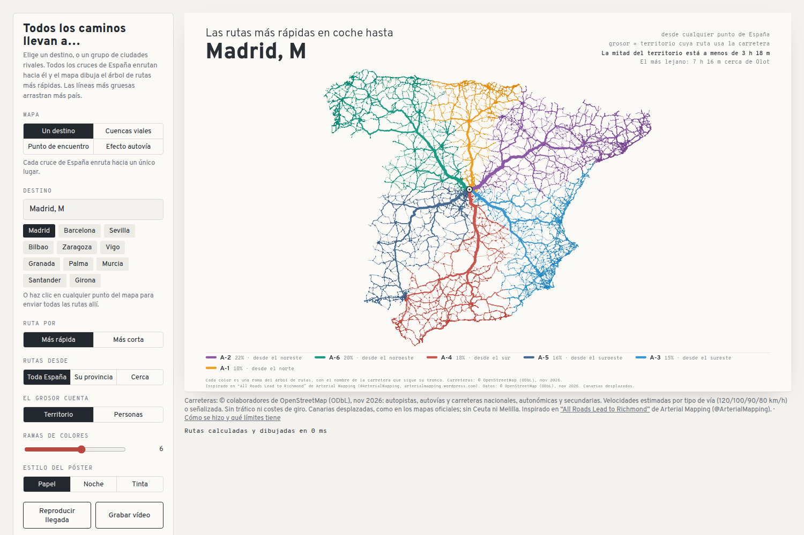
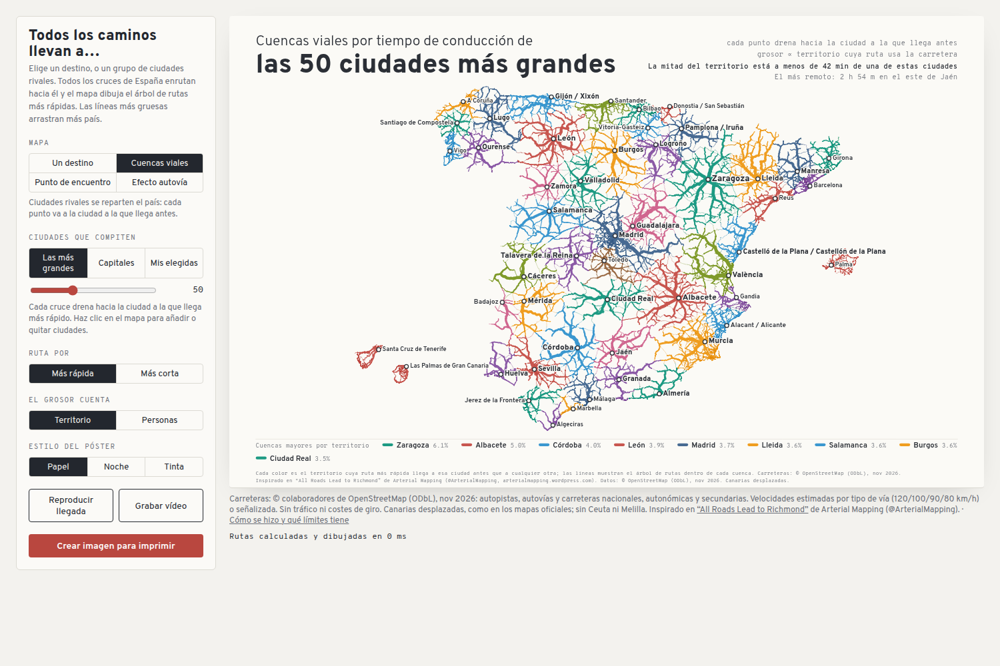

# CuencasTrafico · Todos los caminos llevan a…

**Todos los cruces de la red viaria española enrutados hacia un solo punto.** El mapa dibuja el árbol de rutas más rápidas que llegan hasta allí, y el grosor de cada línea cuenta el territorio —o las personas— que arrastra.

Un mapa interactivo, sin servidor y sin instalar nada: se abre en el navegador, se elige el destino y se genera un póster (o un vídeo) para imprimir.

**[▶ Abrir el mapa](https://ntizar.github.io/CuencasTrafico/)**

---

## De dónde sale la idea

En marzo de 2022, el cartógrafo que firma como **Arterial Mapping** ([@ArterialMapping](https://arterialmapping.wordpress.com/2022/03/20/all-roads-lead-to-richmond-2/)) publicó *«All Roads Lead to Richmond»*: tomó la red viaria de Virginia, enrutó **cada cruce del estado** hacia Richmond y dibujó el resultado. Las carreteras que soportan más tráfico salían más gruesas, así que el estado entero aparecía como un árbol de venas convergiendo en su capital.

La gracia del mapa no era el destino, era la forma: ver de golpe qué ramas del país alimentan a qué nodo, y darse cuenta de que la red viaria tiene una anatomía bastante parecida a la de una cuenca hidrográfica.

El original es de Estados Unidos. Aquí no existía la versión española, así que la hemos hecho.

## Cómo lo trajimos a España

No fue un cambio de coordenadas. El original se apoya en la red de carreteras de un estado; España tiene otra densidad, otras categorías de vía, islas y una geografía que rompe cualquier proyección ingenua. Lo que hicimos:

- **Datos abiertos, no de pago.** Descargamos de **OpenStreetMap** la red completa de autopistas, autovías, carreteras nacionales, autonómicas y secundarias del país, y la comprimimos a un grafo de cruces y tramos con su geometría real. Todo viaja dentro del propio HTML: no hay peticiones a ninguna API al abrir la página.
- **Proyección pensada para España.** Cónica equivalente (equal-area) de Albers con paralelos estándar 37° y 43°, que es la que se usa habitualmente para la península. **Canarias va desplazada** junto a la costa, como en los mapas oficiales, y por eso las rutas a las islas son una simplificación, no un viaje real.
- **Dijkstra multi-fuente, no un viaje.** En lugar de calcular un recorrido, se lanza el algoritmo desde **todos los cruces a la vez** hacia el destino. El resultado son distancias y un árbol de predecesores para toda España en una sola pasada, en el navegador y en milisegundos.
- **Las ramas tienen nombre.** El árbol se descompone en ramas por peso (el hijo «pesado» de cada nodo marca el tronco, y las ramas laterales se van separando de mayor a menor), y cada rama se etiqueta con la carretera que domina su tronco. De ahí salen leyendas del tipo «A-6 · 23 % · desde el noroeste».
- **Pesos a la española.** Cada cruce pesa por superficie o por población, así que el grosor de una línea puede leerse como «cuánto territorio depende de esta carretera» o «cuánta gente la usa».
- **Cuatro mapas en uno.** Al adaptarlo aparecieron tres ideas que el original no tenía y que en España funcionan muy bien: el reparto del país en **cuencas viales** entre ciudades rivales, el **punto de encuentro** óptimo para un grupo de viajeros, y el **efecto autovía** (cuánto acorta cada carretera el viaje hasta un lugar).

## Los cuatro mapas

| Modo | Qué responde |
|---|---|
| **Un destino** | Si todo el país condujera hacia un mismo punto, ¿qué carreteras se llenarían y cuánto? |
| **Cuencas viales** | Dos, diez o cincuenta ciudades se reparten España: cada punto va a la que llega antes. |
| **Punto de encuentro** | Dónde quedar para que **el que más conduce** tarde lo mínimo (o para minimizar la conducción total). |
| **Efecto autovía** | Cuánto tiempo ahorra la red de alta capacidad frente a hacerlo todo por carretera convencional a 80 km/h. |

Y encima, controles para afinar: rutas desde toda España, desde la provincia del destino o solo desde un radio de horas; grosor por territorio o por personas; estilo **papel**, **noche** o **tinta**; ramas de color; animación de llegada, grabación en vídeo y **exportación a PNG de 4800 × 3000 px** listo para imprimir.

## Límites (y errores posibles)

Esto es un mapa para mirar y entender, no un navegador. Conviene decirlo claro:

- **Las velocidades son estimaciones** por tipo de vía (120 / 100 / 90 / 80 km/h) o la señalizada cuando existe. No hay tráfico, ni obras, ni hora punta.
- **No hay costes de giro, peajes ni transbordos.** Un trayecto en ferry o un cambio de isla no se modela: las rutas a Baleares y Canarias acaban en el puerto.
- **Canarias aparece desplazada** y **no están Ceuta ni Melilla**, igual que en la mayoría de mapas de España. Es una convención de representación, no un juicio territorial.
- **El grafo está simplificado** en cruces: dos vías que se cruzan sin enlace pueden compartir nodo. En zonas densas eso puede acortar algún trayecto.
- **Los pesos son aproximaciones** (población y superficie por cruce), así que los porcentajes de la leyenda son orientativos.
- **El punto de encuentro** cae sobre la red viaria, no necesariamente sobre un pueblo; por eso el mapa intenta describirlo («Cerca de Medinaceli, 8 km al norte»).
- **Y sí, puede tener errores.** Se ha construido en unas pocas sesiones de trabajo, sin revisión cartográfica profesional. Si ves algo raro, abre un *issue*: es la forma más rápida de arreglarlo.

## Cómo está hecho

Un solo fichero HTML, sin dependencias ni build. Dentro:

- La red viaria comprimida en un `application/octet-stream` (gzip + arrays tipados) que se descomprime con `DecompressionStream` al abrir.
- Un grafo CSR en `Float32Array` / `Int32Array`, con geometría de cada tramo en deltas acumulados.
- Dijkstra con montículo binario y borrado perezoso, multi-fuente, reutilizado para los cuatro modos.
- Todo el dibujo en `<canvas>` 2D a 1600 × 1000 lógicos, reescalado a la pantalla y a 3× para exportar.
- Tipografías **Overpass** y **Overpass Mono** (SIL OFL), elegidas porque su origen es la señalización de autopistas.

  

## Versión urbana

[`/urbano/`](urbano/) es el hermano a escala de calle: el mismo árbol de rutas, pero
dentro de una ciudad, con sus distritos y sus hitos. Siete ciudades (Madrid, Barcelona,
Valencia, Sevilla, Zaragoza, Málaga y Murcia), cada una con su encuadre.

**[▶ Abrir la versión urbana](https://ntizar.github.io/CuencasTrafico/urbano/)**

El generador está en [`urbano/scripts/`](urbano/scripts/): descarga la red de
OpenStreetMap, la convierte en grafo de cruces y enlaces y la empaqueta en el binario
que consume el HTML. Detalles en [`urbano/README.md`](urbano/README.md).

## Créditos

- **Idea original:** *«All Roads Lead to Richmond»*, Arterial Mapping ([@ArterialMapping](https://arterialmapping.wordpress.com/2022/03/20/all-roads-lead-to-richmond-2/)).
- **Datos:** © colaboradores de [OpenStreetMap](https://www.openstreetmap.org/copyright), bajo **ODbL**. El mapa derivado mantiene la misma licencia para los datos.
- **Tipografías:** Overpass / Overpass Mono, SIL Open Font License.
- **Código y adaptación a España:** David Antizar ([@Ntizar](https://github.com/Ntizar)), con ayuda de Mastermind.

## Licencia

- **Código** (`index.html`, scripts): MIT — ver [LICENSE](LICENSE).
- **Datos viarios**: © OpenStreetMap contributors, ODbL 1.0. Si reutilizas los datos, atribuye y comparte igual.

---

Hecho con ❤️ por David Antizar
